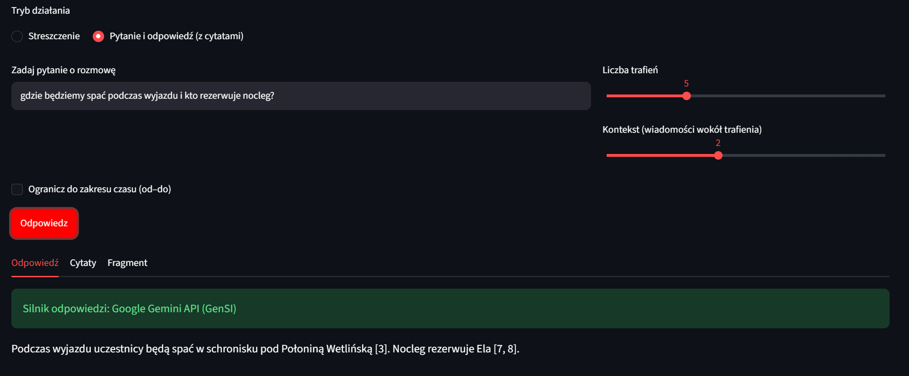
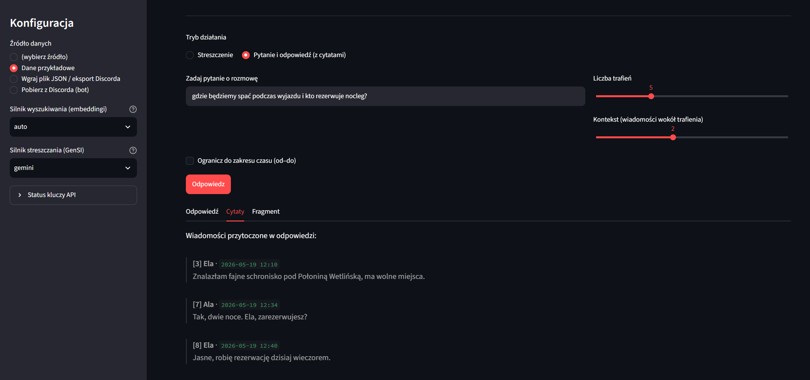

# Streszczacz rozmów z Discorda

Aplikacja webowa do przeszukiwania, streszczania i odpytywania historii czatu z Discorda.
Zadajesz pytanie zwykłym językiem („gdzie będziemy spać na wyjeździe?”), a aplikacja
znajduje pasujące wiadomości i na ich podstawie generuje odpowiedź z cytatami
wskazującymi konkretne wiadomości źródłowe.

Projekt zaliczeniowy z przedmiotu Generatywna Sztuczna Inteligencja.

## Przykład

Pytanie: „gdzie będziemy spać podczas wyjazdu i kto rezerwuje nocleg?”. Żadna wiadomość w rozmowie
nie zawiera słów „spać” ani „nocleg”, a odpowiedź (Google Gemini) wskazuje wiadomości źródłowe:



Zakładka „Cytaty” pokazuje wiadomości, na których opiera się odpowiedź:



## Co potrafi

- **Wyszukiwanie semantyczne**: szuka po znaczeniu, a nie po dokładnych słowach.
- **Streszczanie**: podsumowuje znaleziony wątek albo dowolny przedział czasu (od-do).
- **Pytanie i odpowiedź z cytatami**: odpowiada na pytanie i podaje numery wiadomości, na których się opiera, więc odpowiedź da się sprawdzić.
- **Pobieranie z Discorda**: bot z uprawnieniem do czytania historii pobiera kanał przez oficjalne API. Działa też z plikiem JSON (np. eksport z DiscordChatExporter).

## Jak to działa

```
wiadomości (JSON / Discord API)
        │
        ▼
1. wczytanie i ujednolicenie formatu        data_loader.py, discord_fetch.py
        │
        ▼
2. embeddingi + podobieństwo kosinusowe     search.py
   (opcjonalnie najpierw filtr zakresu dat)
        │
        ▼
3. fragment z kontekstem                    search.py
   (± 2 wiadomości wokół każdego trafienia)
        │
        ▼
4. streszczenie / odpowiedź przez LLM       summarizer.py
   (Gemini, Claude lub GPT)
```

To schemat **RAG** (Retrieval-Augmented Generation): model językowy nie odpowiada „z pamięci”,
tylko na podstawie fragmentów znalezionych w kroku 2.

## Decyzje projektowe

**Embeddingi zamiast wyszukiwania po słowach.** Na danych przykładowych wyszukiwanie TF-IDF
dla zapytania „gdzie będziemy spać podczas wyjazdu” zwraca wiadomość „Gdzie robimy imprezę
urodzinową?”, bo łączy je tylko słowo „gdzie”. Wiadomość o rezerwacji schroniska nie zawiera
słowa „spać”, więc wyszukiwanie po słowach jej nie znajduje. Model `paraphrase-multilingual-MiniLM-L12-v2`
(sentence-transformers) porównuje znaczenie zdań i działa także po polsku: dla tego samego pytania
wszystkie 5 trafień pochodzi z wątku o noclegu („Ile za noc?”, „Znalazłam fajne schronisko pod
Połoniną Wetlińską…”, „Tak, dwie noce. Ela, zarezerwujesz?”), choć żadne nie zawiera słów z zapytania.

**Kontekst wokół trafień.** Pojedyncza wiadomość („Biorę. Rezerwujemy dwie noce?”) bez sąsiednich
nic nie mówi. Dlatego do każdego trafienia dokładane są wiadomości przed i po, a nakładające się
fragmenty są scalane.

**Cytaty w odpowiedziach.** Wiadomości są numerowane, a model ma polecenie odpowiadać wyłącznie
na ich podstawie i podawać numery źródeł, np. `[3, 7]`. Aplikacja wyświetla cytowane wiadomości
obok odpowiedzi. Ogranicza to zmyślanie i pozwala sprawdzić każdą informację.

**Tryby awaryjne.** Bez biblioteki sentence-transformers wyszukiwanie przechodzi na TF-IDF,
a bez klucza API streszczanie wybiera najważniejsze wiadomości metodą częstości słów.
Aplikacja zawsze coś zwraca, nawet bez internetu.

**Prywatność.** Embeddingi liczone są lokalnie. Do dostawcy LLM wysyłany jest tylko wybrany
fragment rozmowy, a w trybie awaryjnym nic nie opuszcza komputera.

## Uruchomienie

```bash
pip install -r requirements.txt
python generate_data.py        # dane przykładowe (fikcyjna rozmowa)
streamlit run app.py
```

Do streszczeń generowanych przez LLM skopiuj `.env.example` do `.env` i wpisz jeden klucz API
(Gemini, Anthropic lub OpenAI). Bez klucza działa tryb awaryjny.

## Struktura

| Plik | Rola |
|---|---|
| `app.py` | interfejs w Streamlit |
| `data_loader.py` | wczytanie JSON (eksport Discorda lub prosty format) |
| `discord_fetch.py` | pobieranie kanału przez bota (Discord REST API) |
| `search.py` | embeddingi, filtr czasu, budowa fragmentu |
| `summarizer.py` | streszczanie i Q&A przez LLM, tryb awaryjny |
| `generate_data.py` | generator fikcyjnej rozmowy do testów |
| `discord_seed.py` | wysyła rozmowę testową na własny kanał przez webhook |
| `docs/` | zrzuty ekranu użyte w README |

## Ograniczenia

- Tylko tekst, bez obrazów i załączników.
- Embeddingi trzymane są w pamięci. Przy dużych kanałach przydałaby się baza wektorowa (np. FAISS, Chroma).
- Webhook nie pozwala ustawić daty wiadomości, więc filtr czasu najlepiej testować na danych syntetycznych.
- Krótkie zapytania z jednym specjalistycznym słowem (np. „embeddingi”) model semantyczny dopasowuje słabiej.
  Rozwiązaniem byłoby wyszukiwanie hybrydowe: embeddingi połączone z wyszukiwaniem po słowach.

## Jak powstał projekt

Projekt zbudowałem metodą AI-assisted development: kod generował asystent AI na podstawie
wymagań, które określiłem. Ja testowałem aplikację na danych syntetycznych i na prawdziwym
serwerze Discord oraz przygotowałem dokumentację.
